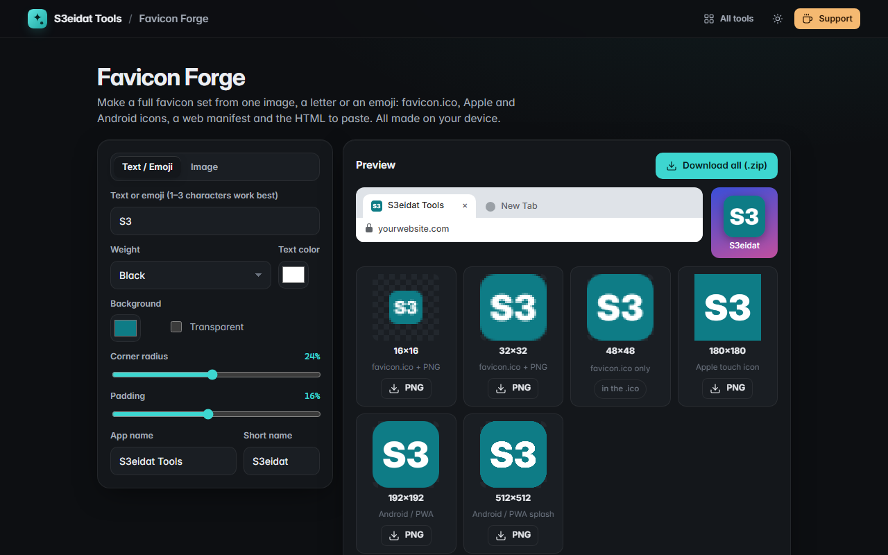

# Favicon Forge

> Make a complete favicon set from one image, a letter or an emoji. Free, private, and it runs entirely in your browser.

### ▶ [Open Favicon Forge](https://s3eidat.github.io/favicon-forge/)



## Features

- Start from an **image** (PNG, JPG, WebP, SVG; fit inside or fill) or from **text / emoji**
- **Background color** or transparent, **corner radius** (square to circle) and **padding**
- **favicon.ico** with 16, 32 and 48 px images inside (PNG-in-ICO, written by the tool itself)
- **apple-touch-icon.png** (180 px, always solid so iOS doesn't show black corners)
- **Android / PWA icons** 192 and 512 px, plus a ready **site.webmanifest** with your app name and colors
- The **HTML snippet** for your `<head>`, one click to copy
- Live previews: a browser tab, a phone home screen, and every size at real pixels
- Download one PNG or **everything as a .zip**

## Privacy


Your images never leave your device. There is no server, no account, no analytics.
The page ships with a strict Content-Security-Policy (`connect-src 'self'`), so the browser
itself blocks any attempt to send data anywhere.

## Run it yourself

It's plain HTML, CSS and JavaScript with no build step:

```bash
git clone https://github.com/s3eidat/favicon-forge
cd favicon-forge
python -m http.server 8000
```

Then open http://localhost:8000.

## Support

If this saved you time, **[buy me a coffee ☕](https://s3eidat.github.io/coffee/)**. It keeps every tool free.

---

Part of **[S3eidat Tools](https://s3eidat.github.io/)**: 100+ free, private tools that run in your browser. MIT licensed.
